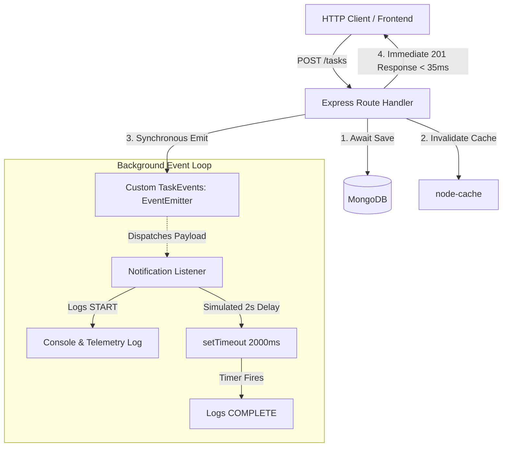

# Technical Implementation Architecture: Event-Driven Processing with Node.js EventEmitter

**University:** CHAROTAR UNIVERSITY OF SCIENCE AND TECHNOLOGY (CHARUSAT)  
**Course:** Advanced Web Development Frameworks (ITUE301) — Sem 5  
**Practical 10:** Asynchronous Processing with Event-Driven Architecture  

---

## 1. Architectural Overview

Practical 10 decouples synchronous HTTP client interactions from asynchronous, high-latency side effects (e.g., email notifications, activity auditing, telemetry logging). By utilizing Node.js's built-in `EventEmitter` class (`require('events')`), the system processes notifications in the background on the event loop without imposing any artificial latency on the client HTTP response.

### Architectural Decoupling Diagram



---

## 2. Component Implementation Details

### 2.1 The Event Emitter Core ([`task-manager-api/events.js`](file:///v:/AIML(sub)/sem%205/ADWF/Practical/AWDF/task-manager-api/events.js))
- Uses Node.js's native `events` module.
- Extends the `EventEmitter` class to form `TaskEvents`.
- Configures `setMaxListeners(20)` to prevent listener leak warnings when multiple decoupled services attach listeners.
- Exports a singleton instance of `taskEvents` across the application.

```javascript
const EventEmitter = require('events');

class TaskEvents extends EventEmitter {}

const taskEvents = new TaskEvents();
taskEvents.setMaxListeners(20);

module.exports = taskEvents;
```

### 2.2 Notification Listeners ([`task-manager-api/listeners.js`](file:///v:/AIML(sub)/sem%205/ADWF/Practical/AWDF/task-manager-api/listeners.js))
- Registers listeners for `task-created`, `task-updated`, and `task-deleted`.
- Implements a simulated 2-second background delivery using `setTimeout`.
- Logs event lifecycle with standardized markers:
  - `[Notification START] Task: <Title> | Assigned user: <User> | Time: <ISO>`
  - `[Notification COMPLETE] Task: <Title> | Time: <ISO>`
- Captures telemetry logs into memory for verification via `GET /notifications/logs`.

```javascript
taskEvents.on('task-created', (data) => {
  try {
    const { taskId, title, ownerEmail, ownerId } = data || {};
    const startTime = new Date().toISOString();
    const safeUser = ownerEmail || ownerId || 'unassigned';

    console.log(`[Notification START] Task: ${title} | Assigned user: ${safeUser} | Time: ${startTime}`);

    setTimeout(() => {
      const completeTime = new Date().toISOString();
      console.log(`[Notification COMPLETE] Task: ${title} | Time: ${completeTime}`);
      notificationLogs.push({ ... });
    }, 2000);
  } catch (err) {
    console.error('[Notification ERROR]:', err.message);
  }
});
```

### 2.3 Express Route Integration ([`task-manager-api/server.js`](file:///v:/AIML(sub)/sem%205/ADWF/Practical/AWDF/task-manager-api/server.js))
- Integrated into `POST /tasks`:
  ```javascript
  taskEvents.emit('task-created', {
    taskId: newTask._id.toString(),
    title: newTask.title,
    ownerId: req.user.id,
    ownerEmail: req.user.email || 'user',
    timestamp: new Date().toISOString(),
  });
  ```
- Integrated into `PUT /tasks/:id` and `PATCH /tasks/:id` emitting `task-updated`.
- Integrated into `DELETE /tasks/:id` emitting `task-deleted`.
- Response is dispatched to client **before** background processing finishes, ensuring fast responsiveness.

---

## 3. Telemetry and Debugging Endpoints

| Endpoint | Method | Description |
| :--- | :---: | :--- |
| `/notifications/logs` | `GET` | Returns JSON of all processed background notifications. |
| `/notifications/clear` | `POST` | Flushes the in-memory telemetry notification log. |
| `/debug/cache` | `GET` | Preserved Practical 9 cache statistics endpoint. |

---

## 4. Verification Evidence

1. **HTTP Client Response Time:** ~28 ms (client receives `201 Created` immediately).
2. **Notification Processing Window:** Logs show `Notification START` at $T_0$, and `Notification COMPLETE` at $T_0 + 2013\text{ ms}$.
3. **Automated Test Results:** All 6 Practical 10 integration tests passed (`test/events_integration.test.js`).
