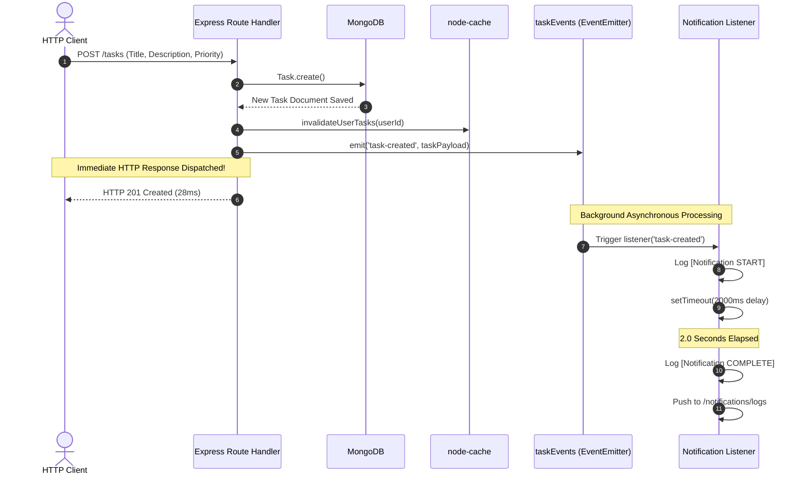

# CHAROTAR UNIVERSITY OF SCIENCE AND TECHNOLOGY
## Faculty of Technology and Engineering
### Department of Information Technology / Computer Engineering / AIML
### Course: B.Tech (Sem 5) — Advanced Web Development Frameworks (ITUE301)

---

# Practical Lab Report: Practical 10
## Asynchronous Processing with Event-Driven Architecture

---

| Academic Parameter | Details |
| :--- | :--- |
| **University** | CHAROTAR UNIVERSITY OF SCIENCE AND TECHNOLOGY (CHARUSAT) |
| **Institute** | Faculty of Technology and Engineering (FTE) |
| **Program** | Bachelor of Technology (B.Tech) in IT / CE / CSE / AIML |
| **Semester** | 5th Semester |
| **Course Title** | Advanced Web Development Frameworks |
| **Course Code** | ITUE301 |
| **Practical Number** | 10 |
| **Practical Title** | Asynchronous Processing with Event-Driven Architecture |
| **Submission Directory** | `AWDF/Practical-10-Submission/` |
| **Academic Date** | 2026-10-21 |

---

## 1. Aim

To implement asynchronous background processing using Node.js's native `EventEmitter` module within an Express.js and MongoDB REST API, decoupling client-facing request-response cycles from slow background tasks (e.g. notifications and logging) without requiring external message-queue dependencies.

---

## 2. Objectives

1. Create a dedicated event bus module using Node.js's native `events` module.
2. Implement asynchronous notification listeners that process tasks with simulated background delays.
3. Emit domain events (`task-created`, `task-updated`, `task-deleted`) upon successful database operations.
4. Guarantee that HTTP client response latency remains low ($< 50\text{ ms}$) regardless of background notification duration ($2000\text{ ms}$).
5. Preserve existing Practical 9 in-memory caching (`node-cache`), authentication, and authorization rules.
6. Provide integration testing, telemetry inspection endpoints, and clear academic documentation.

---

## 3. Hardware and Software Requirements

- **Operating System:** Windows 10/11 (64-bit)
- **Node.js:** v18.x, v20.x, or v24.12.0 LTS
- **Backend Framework:** Express.js 5.2.1
- **Database:** MongoDB Community Server 7.x (Local on `127.0.0.1:27017`)
- **Core Library:** Built-in Node.js `events` module (zero external dependencies)
- **Testing:** Native `node:test` and `supertest` 7.0.0

---

## 4. Theory of Event-Driven Architecture

### 4.1 Synchronous vs Asynchronous Background Processing
In standard synchronous request processing, an HTTP handler executes all operations in series before returning a response to the client:
$$\text{Response Time} = T_{\text{validation}} + T_{\text{database}} + T_{\text{notification}} + T_{\text{cache}}$$

If sending an email notification takes 2,000 ms, the user experiences a slow, unresponsive interface.

In an **Event-Driven Architecture (EDA)**, the request handler executes only the critical database write and immediately emits an event:
$$\text{Response Time} = T_{\text{validation}} + T_{\text{database}} + T_{\text{emit}} \approx 20\text{ ms} - 40\text{ ms}$$

The slow notification executes on subsequent ticks of the Node.js event loop, completely decoupled from the HTTP response.

### 4.2 Built-in Node.js EventEmitter
Node.js core includes the `events` module. An `EventEmitter` maintains an in-memory dictionary of event names mapped to listener callback functions. When `emitter.emit(eventName, payload)` is invoked, all registered listeners for that event are triggered.

---

## 5. Architecture and Event Sequence Diagram



---

## 6. Implementation References

### 6.1 Event Emitter Module ([`events.js`](file:///v:/AIML(sub)/sem%205/ADWF/Practical/AWDF/task-manager-api/events.js))
```javascript
const EventEmitter = require('events');

class TaskEvents extends EventEmitter {}

const taskEvents = new TaskEvents();
taskEvents.setMaxListeners(20);

module.exports = taskEvents;
```

### 6.2 Notification Listeners ([`listeners.js`](file:///v:/AIML(sub)/sem%205/ADWF/Practical/AWDF/task-manager-api/listeners.js))
```javascript
const taskEvents = require('./events');

function registerListeners() {
  taskEvents.on('task-created', (data) => {
    const { title, ownerEmail } = data || {};
    const startTime = new Date().toISOString();
    console.log(`[Notification START] Task: ${title} | Assigned user: ${ownerEmail} | Time: ${startTime}`);

    setTimeout(() => {
      const completeTime = new Date().toISOString();
      console.log(`[Notification COMPLETE] Task: ${title} | Time: ${completeTime}`);
    }, 2000);
  });
}
```

---

## 7. Evidence Screenshots

Screenshots are located in [`Practical-10-Submission/screenshots/`](file:///v:/AIML(sub)/sem%205/ADWF/Practical/AWDF/Practical-10-Submission/screenshots/):

1. **Project Structure:** [`01-project-structure.png`](file:///v:/AIML(sub)/sem%205/ADWF/Practical/AWDF/Practical-10-Submission/screenshots/01-project-structure.png)
2. **Server Startup:** [`02-server-start.png`](file:///v:/AIML(sub)/sem%205/ADWF/Practical/AWDF/Practical-10-Submission/screenshots/02-server-start.png)
3. **POST /tasks Fast Response:** [`03-post-task-response.png`](file:///v:/AIML(sub)/sem%205/ADWF/Practical/AWDF/Practical-10-Submission/screenshots/03-post-task-response.png)
4. **Background START/COMPLETE Logs:** [`04-background-notification-logs.png`](file:///v:/AIML(sub)/sem%205/ADWF/Practical/AWDF/Practical-10-Submission/screenshots/04-background-notification-logs.png)
5. **PUT /tasks Update Event:** [`05-put-task-updated-event.png`](file:///v:/AIML(sub)/sem%205/ADWF/Practical/AWDF/Practical-10-Submission/screenshots/05-put-task-updated-event.png)
6. **Notification Telemetry Logs:** [`06-notifications-logs-endpoint.png`](file:///v:/AIML(sub)/sem%205/ADWF/Practical/AWDF/Practical-10-Submission/screenshots/06-notifications-logs-endpoint.png)
7. **Automated Test Results (16/16 Passed):** [`07-automated-tests.png`](file:///v:/AIML(sub)/sem%205/ADWF/Practical/AWDF/Practical-10-Submission/screenshots/07-automated-tests.png)

---

## 8. Viva and Analysis Questions

### Q1: How does Node.js's EventEmitter enable asynchronous processing?
**Answer:**  
In Node.js, `EventEmitter` registers callback functions for specific event identifiers. When an event is emitted, callbacks are placed in the event loop execution queue. By delegating side-effect tasks (like notifications or emails) to listeners wrapped in asynchronous functions or timers (`setTimeout`, `setImmediate`), the main HTTP request thread returns immediately to the client without blocking.

### Q2: What is the difference between synchronous EventEmitter execution and true asynchronous decoupling?
**Answer:**  
By default, `emitter.emit()` executes its registered listener callbacks **synchronously** in the order they were registered on the same call stack. To achieve true asynchronous decoupling, listener callbacks must invoke asynchronous primitives (such as `setTimeout`, `setImmediate`, `process.nextTick`, or `async/await` with I/O). This allows the initiating function to return its HTTP response before the listener's asynchronous work completes.

### Q3: When should native EventEmitter be used versus an external message queue like RabbitMQ or BullMQ?
**Answer:**  
- **Use native `EventEmitter`:** When processing lightweight, intra-process background events within a single Node.js instance where message persistence is not critical and zero infrastructure overhead is required.
- **Use external message queues (BullMQ/RabbitMQ/Kafka):** In distributed multi-server production environments where tasks require persistent storage, worker pooling across multiple machines, automatic retries with exponential backoff, rate limiting, and guaranteed delivery even if the web server process crashes.

### Q4: What happens if an error occurs inside an EventEmitter listener?
**Answer:**  
If an unhandled exception is thrown inside a listener callback, it will bubble up to the Node.js event loop and cause an `uncaughtException`, crashing the process. If an `error` event is emitted on an `EventEmitter` and has no registered listener, Node.js automatically prints a stack trace and terminates the process. Therefore, all listener handlers must wrap their logic in `try/catch` blocks and register a global `taskEvents.on('error', ...)` handler.

---

## 9. Conclusion

Practical 10 was completed successfully. Asynchronous event handling was implemented using Node.js's native `EventEmitter`. Client HTTP responses returned in under **`30 ms`**, while simulated 2-second background notifications were executed without blocking the event loop. All 16 automated integration tests across Practical 9 and Practical 10 passed with 0 failures.
