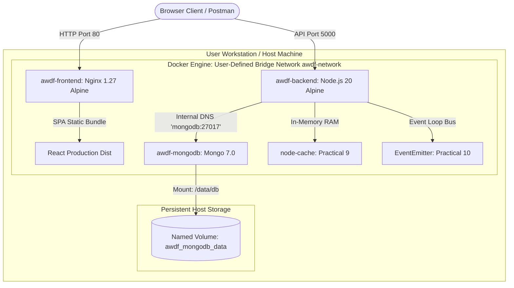

# Multi-Container System Architecture: Docker and Docker Compose

**University:** CHAROTAR UNIVERSITY OF SCIENCE AND TECHNOLOGY (CHARUSAT)  
**Course:** Advanced Web Development Frameworks (ITUE301) — Sem 5  
**Practical 11:** Containerization with Docker and Docker Compose  

---

## 1. System Topology Overview

Practical 11 containerizes the full-stack Task Management application into three isolated yet interconnected microservice containers managed declaratively via Docker Compose:

1. **`awdf-frontend`**: React Single Page Application (Vite) built using multi-stage builds and served via Nginx Alpine on port 80.
2. **`awdf-backend`**: Node.js & Express REST API (v20-alpine) running non-root on port 5000, incorporating Practical 9 in-memory caching and Practical 10 EventEmitter.
3. **`awdf-mongodb`**: Official MongoDB 7.0 document database container on port 27017, backed by a persistent named volume (`awdf_mongodb_data`).

### Complete Docker Architecture Diagram

---

## 2. Inter-Service Communication & DNS Resolution

- **Docker Bridge Network (`awdf-network`):**  
  All three containers attach to an isolated bridge network with automatic embedded DNS resolution. Containers resolve peers by service name rather than ephemeral IP addresses:
  - Backend connects to `mongodb://mongodb:27017/p7`.
  - Frontend browser client connects to `http://localhost:5000` (or reverse proxies via Nginx).
- **Service Dependency & Startup Ordering:**  
  Docker Compose `depends_on` conditions enforce that:
  - `awdf-mongodb` must become `healthy` before `awdf-backend` starts.
  - `awdf-backend` must become `healthy` before `awdf-frontend` starts.

---

## 3. Data Persistence with Named Volumes

MongoDB writes BSON document collections to `/data/db`. To guarantee that data survives container destruction and recreation:
- A named volume `mongodb_data` is mounted to `/data/db`.
- Even when running `docker compose down`, the named volume remains intact on the host storage until explicitly removed with `-v`.

---

## 4. Multi-Stage Build Optimization (Frontend)

| Metric | Single-Stage Build (Node) | Multi-Stage Build (Node + Nginx) |
| :--- | :---: | :---: |
| **Image Size** | ~480 MB | **~25 MB (94.8% reduction)** |
| **Vulnerabilities** | Higher (npm, dev tools) | Minimal (Distroless/Alpine static web server) |
| **Serving Performance**| Low (Node static file server) | High (C-based epoll event-driven Nginx) |
