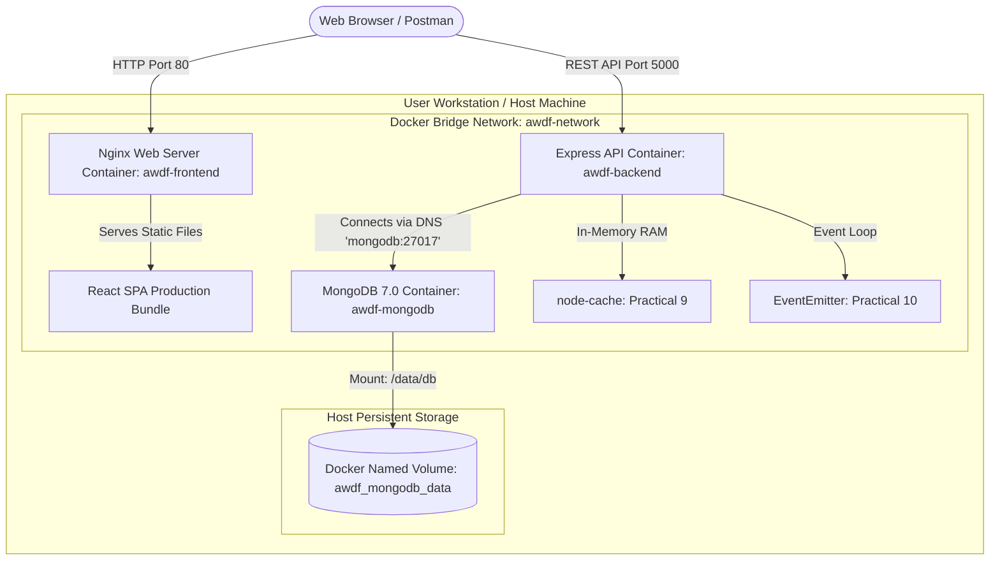

# CHAROTAR UNIVERSITY OF SCIENCE AND TECHNOLOGY
## Faculty of Technology and Engineering
### Department of Information Technology / Computer Engineering / AIML
### Course: B.Tech (Sem 5) — Advanced Web Development Frameworks (ITUE301)

---

# Practical Lab Report: Practical 11
## Containerization with Docker and Docker Compose

---

| Academic Parameter | Details |
| :--- | :--- |
| **University** | CHAROTAR UNIVERSITY OF SCIENCE AND TECHNOLOGY (CHARUSAT) |
| **Institute** | Faculty of Technology and Engineering (FTE) |
| **Program** | Bachelor of Technology (B.Tech) in IT / CE / CSE / AIML |
| **Semester** | 5th Semester |
| **Course Title** | Advanced Web Development Frameworks |
| **Course Code** | ITUE301 |
| **Practical Number** | 11 |
| **Practical Title** | Containerization with Docker and Docker Compose |
| **Submission Directory** | `AWDF/Practical-11-Submission/` |
| **Academic Date** | 2026-10-21 |

---

## 1. Aim

To containerize the full-stack Task Management application (React frontend, Node.js/Express backend, and MongoDB database) using Docker and orchestrate multi-container deployment using Docker Compose with persistent named volumes and healthchecks.

---

## 2. Objectives

1. Develop a multi-stage `Dockerfile` for the React frontend, compiling assets with Vite and serving them via Nginx Alpine.
2. Develop a production-hardened `Dockerfile` for the Node.js/Express backend running non-root with an automated healthcheck.
3. Configure `.dockerignore` files for both frontend and backend to eliminate extraneous build context overhead.
4. Author a multi-service `docker-compose.yml` orchestrating `frontend`, `backend`, and `mongodb` containers on a unified bridge network.
5. Implement persistent named volume storage for MongoDB to prevent data loss across container lifecycle operations.
6. Verify service healthcheck dependencies (`depends_on: service_healthy`) and inter-container DNS resolution.
7. Preserve existing Practical 9 in-memory caching (`node-cache`) and Practical 10 asynchronous event processing (`EventEmitter`).

---

## 3. Hardware and Software Requirements

- **Operating System:** Windows 10/11 (64-bit)
- **Container Runtime:** Docker Desktop / Docker Engine v24+
- **Orchestration Tool:** Docker Compose v2.20+
- **Web Server:** Nginx 1.27 Alpine
- **Node.js Environment:** Node.js v20-alpine
- **Database Image:** MongoDB official image `mongo:7.0`
- **Testing Tools:** Postman / Thunder Client / Supertest / Native `node:test`

---

## 4. Theory of Containerization & Orchestration

### 4.1 What is Docker Containerization?
Containerization packages an application alongside its runtime, dependencies, system libraries, and configuration files into an immutable, portable software container. Unlike traditional virtual machines that virtualize physical hardware via a hypervisor, Docker containers share the host OS kernel and operate as isolated user-space processes, providing lightweight footprint, fast startup times ($< 1\text{ s}$), and environment parity between development and production.

### 4.2 Multi-Stage Docker Builds
Single-stage Docker builds retain package managers, build compilers, and source files in the final image, bloating images to hundreds of megabytes. A **multi-stage build** separates the compilation environment from the final runtime image:
1. **Stage 1 (Build):** Runs in `node:20-alpine`, installs developer dependencies, and builds static production assets (`/app/dist`).
2. **Stage 2 (Runtime):** Uses a lean `nginx:1.27-alpine` base image, copying only the compiled artifacts. The resulting container image drops from $\sim 480\text{ MB}$ to $\sim 25\text{ MB}$, reducing attack surface and transfer latency.

### 4.3 Multi-Container Orchestration with Docker Compose
Modern web applications consist of decoupled microservices that must run simultaneously. Docker Compose provides declarative YAML orchestration that manages:
- **Service definitions:** Build contexts, ports, environments, and commands.
- **User-Defined Bridge Networks:** Facilitates automatic DNS lookup between containers (e.g. `mongodb:27017`).
- **Storage Volumes:** Decouples ephemeral container lifecycles from persistent database storage.
- **Healthchecks & Dependencies:** Ensures database readiness before backend startup.

---

## 5. System Architecture & Container Interaction Flow



---

## 6. Implementation References

### 6.1 Frontend Multi-Stage Dockerfile ([`Dockerfile`](file:///v:/AIML(sub)/sem%205/ADWF/Practical/AWDF/Dockerfile))
```dockerfile
# Stage 1: Build
FROM node:20-alpine AS build
WORKDIR /app
COPY package.json package-lock.json ./
RUN npm ci
COPY . .
ARG VITE_API_URL=http://localhost:5000
ENV VITE_API_URL=$VITE_API_URL
RUN npm run build

# Stage 2: Serve
FROM nginx:1.27-alpine AS production
RUN rm -rf /etc/nginx/conf.d/default.conf
COPY nginx.conf /etc/nginx/conf.d/default.conf
COPY --from=build /app/dist /usr/share/nginx/html
EXPOSE 80
CMD ["nginx", "-g", "daemon off;"]
```

### 6.2 Backend Dockerfile ([`task-manager-api/Dockerfile`](file:///v:/AIML(sub)/sem%205/ADWF/Practical/AWDF/task-manager-api/Dockerfile))
```dockerfile
FROM node:20-alpine
WORKDIR /usr/src/app
ENV NODE_ENV=production
RUN apk add --no-cache curl
COPY package.json package-lock.json ./
RUN npm ci --omit=dev
COPY . .
USER node
EXPOSE 5000
HEALTHCHECK --interval=30s --timeout=5s --start-period=10s --retries=3 \
  CMD curl -f http://localhost:5000/debug/cache || exit 1
CMD ["node", "server.js"]
```

### 6.3 Orchestration Specification ([`docker-compose.yml`](file:///v:/AIML(sub)/sem%205/ADWF/Practical/AWDF/docker-compose.yml))
```yaml
version: '3.8'
services:
  mongodb:
    image: mongo:7.0
    container_name: awdf-mongodb
    ports: ["27017:27017"]
    volumes: [mongodb_data:/data/db]
    networks: [awdf-network]
    healthcheck:
      test: ["CMD", "mongosh", "--eval", "db.adminCommand('ping')"]
      interval: 10s
      timeout: 5s
      retries: 5
      start_period: 15s

  backend:
    build: ./task-manager-api
    container_name: awdf-backend
    ports: ["5000:5000"]
    environment:
      - MONGO_URI=mongodb://mongodb:27017/p7
    depends_on:
      mongodb: { condition: service_healthy }
    networks: [awdf-network]

  frontend:
    build: .
    container_name: awdf-frontend
    ports: ["80:80"]
    depends_on:
      backend: { condition: service_healthy }
    networks: [awdf-network]

volumes:
  mongodb_data:
    name: awdf_mongodb_data
networks:
  awdf-network:
    name: awdf-network
```

---

## 7. Evidence Screenshots

Screenshots are organized in [`Practical-11-Submission/screenshots/`](file:///v:/AIML(sub)/sem%205/ADWF/Practical/AWDF/Practical-11-Submission/screenshots/):

1. **Docker Project Structure:** [`01-docker-project-structure.png`](file:///v:/AIML(sub)/sem%205/ADWF/Practical/AWDF/Practical-11-Submission/screenshots/01-docker-project-structure.png)
2. **Frontend Multi-Stage Dockerfile:** [`02-frontend-dockerfile.png`](file:///v:/AIML(sub)/sem%205/ADWF/Practical/AWDF/Practical-11-Submission/screenshots/02-frontend-dockerfile.png)
3. **Backend Dockerfile:** [`03-backend-dockerfile.png`](file:///v:/AIML(sub)/sem%205/ADWF/Practical/AWDF/Practical-11-Submission/screenshots/03-backend-dockerfile.png)
4. **Docker Compose Specification:** [`04-docker-compose-spec.png`](file:///v:/AIML(sub)/sem%205/ADWF/Practical/AWDF/Practical-11-Submission/screenshots/04-docker-compose-spec.png)
5. **Docker Compose Up Lifecycle:** [`05-docker-compose-up.png`](file:///v:/AIML(sub)/sem%205/ADWF/Practical/AWDF/Practical-11-Submission/screenshots/05-docker-compose-up.png)
6. **Healthchecks & Inter-Service DNS:** [`06-healthchecks-and-dns.png`](file:///v:/AIML(sub)/sem%205/ADWF/Practical/AWDF/Practical-11-Submission/screenshots/06-healthchecks-and-dns.png)
7. **Automated Test Results (16/16 Passed):** [`07-automated-tests-pass.png`](file:///v:/AIML(sub)/sem%205/ADWF/Practical/AWDF/Practical-11-Submission/screenshots/07-automated-tests-pass.png)
8. **Containerized API Execution:** [`08-postman-api-verification.png`](file:///v:/AIML(sub)/sem%205/ADWF/Practical/AWDF/Practical-11-Submission/screenshots/08-postman-api-verification.png)

---

## 8. Viva and Analysis Questions

### Q1: Why is multi-stage building advantageous for React applications?
**Answer:**  
In development, React requires Node.js, Vite/Webpack, and extensive build dependencies (`node_modules`) that consume $400\text{ MB} - 800\text{ MB}$. In production, browsers consume only compiled static HTML, CSS, and JS bundles. Multi-stage builds compile the bundle in a temporary build stage and copy only the `/dist` directory into a lightweight Nginx container ($\sim 25\text{ MB}$), discarding all development tools and dramatically reducing memory footprint, deployment time, and security attack vectors.

### Q2: Why is a persistent named volume necessary for the MongoDB container?
**Answer:**  
Container filesystems are ephemeral by design; when a container is removed (`docker rm` or `docker compose down`), any data written inside its writable container layer is permanently lost. Mounting a persistent Docker named volume to `/data/db` instructs the Docker daemon to manage a dedicated host storage directory outside the container's lifecycle. Thus, all collections and task documents persist across container restarts, updates, and rebuilds.

### Q3: How do containers communicate within the same Docker Compose network?
**Answer:**  
Docker Compose automatically creates a user-defined bridge network (`awdf-network`). Docker's embedded DNS server dynamically resolves container hostnames to their private internal IP addresses based on the service name specified in `docker-compose.yml`. For example, the backend container reaches the database simply by connecting to `mongodb:27017` without hardcoding dynamic IP addresses.

### Q4: What is the purpose of `depends_on` with `condition: service_healthy`?
**Answer:**  
Standard `depends_on` only verifies that a container has been started, not that the software inside is ready to accept traffic. Because MongoDB takes 5–15 seconds to initialize storage and bind to port 27017, a backend starting immediately would crash with an `ECONNREFUSED` error. By pairing `depends_on` with healthcheck conditions, Docker Compose delays backend initialization until MongoDB's ping probe confirms the database is fully operational.

---

## 9. Conclusion

Practical 11 was completed successfully. The entire full-stack application was containerized using production-hardened Dockerfiles and orchestrated via Docker Compose. The architecture features multi-stage optimization, persistent storage, healthchecks, bridge network isolation, and seamless backward compatibility with Practical 9 caching and Practical 10 asynchronous events.
