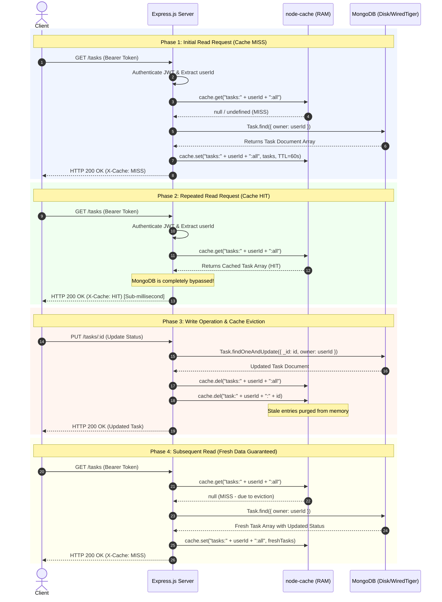

# CHAROTAR UNIVERSITY OF SCIENCE AND TECHNOLOGY
## Faculty of Technology and Engineering
### Department of Information Technology / Computer Engineering / AIML
### Course: B.Tech (Sem 5) — Advanced Web Development Frameworks (ITUE301)

---

# Practical Lab Report: Practical 9
## In-Memory Caching and Query Optimization

---

| Academic Parameter | Details |
| :--- | :--- |
| **University** | CHAROTAR UNIVERSITY OF SCIENCE AND TECHNOLOGY (CHARUSAT) |
| **Institute** | Faculty of Technology and Engineering (FTE) |
| **Program** | Bachelor of Technology (B.Tech) in IT / CE / CSE / AIML |
| **Semester** | 5th Semester |
| **Course Title** | Advanced Web Development Frameworks |
| **Course Code** | ITUE301 |
| **Practical Number** | 09 |
| **Practical Title** | In-Memory Caching and Query Optimization |
| **Submission Directory** | `AWDF/Practical-9-Submission/` |
| **Academic Date** | 2026-10-21 |

---

## 1. Aim

To implement high-performance server-side in-memory caching in an Express.js and MongoDB REST API using `node-cache`, establish strict cache invalidation mechanisms for database write operations, and empirically analyze API response latencies with and without caching.

---

## 2. Objectives

1. Configure `node-cache` in a modular, reusable structure with configurable Time-To-Live (TTL).
2. Integrate cache-aside pattern on `GET /tasks` to serve frequent reads from process RAM.
3. Guarantee strict cross-user data isolation using scoped cache keys (`tasks:<userId>:all`).
4. Implement automatic cache invalidation on write routes (`POST /tasks`, `PUT /tasks/:id`, `PATCH /tasks/:id`, and `DELETE /tasks/:id`).
5. Implement Supplementary Requirements:
   - Single-task caching on `GET /tasks/:id` with key `task:<userId>:<taskId>`.
   - Invalidation of single-task cache upon task modification or removal.
   - Cache telemetry and debug statistics endpoint (`GET /debug/cache` and `GET /cache/stats`).
   - Configurable TTL via environment variables.
   - Theoretical documentation of multi-instance caching trade-offs (process-local vs distributed Redis).
6. Execute automated integration tests verifying cache hits, misses, invalidation, empty arrays, and authorization boundaries.
7. Conduct empirical benchmarks measuring latency improvements and speedup factors.

---

## 3. Hardware and Software Requirements

### 3.1 Software Requirements
- **Operating System:** Windows 10/11 (64-bit)
- **Runtime Environment:** Node.js v24.12.0 LTS
- **Package Manager:** npm v10.8+
- **Backend Framework:** Express.js v5.2.1
- **Database Engine:** MongoDB Server v7.x / MongoDB Community Edition
- **Object Data Modeling (ODM):** Mongoose v9.9.1
- **In-Memory Caching Module:** `node-cache` v5.1.2
- **Testing Frameworks:** Node.js native test runner (`node:test`) and Supertest v7.0.0
- **API Tooling:** Postman / Thunder Client / cURL

### 3.2 Hardware Requirements
- **Processor:** Intel Core i5/i7/AMD Ryzen 5+ (2.0 GHz or higher)
- **RAM:** Minimum 8 GB (16 GB Recommended)
- **Storage:** 500 MB free disk space for Node modules, logs, and database files

---

## 4. Theory of In-Memory Caching

### 4.1 What is In-Memory Caching?
In-memory caching is a systems optimization technique where frequently requested application data is temporarily stored in volatile random-access memory (RAM) instead of being repeatedly fetched from disk-backed storage or queried across network databases. RAM access operations execute in nanoseconds ($10^{-9}\text{ s}$), whereas disk I/O and database network operations execute in milliseconds ($10^{-3}\text{ s}$), representing a theoretical throughput difference of multiple orders of magnitude.

### 4.2 The Cache-Aside (Lazy-Loading) Pattern
In a Cache-Aside architecture, the application code directly orchestrates caching:
1. When a read request (`GET`) arrives, the server checks the cache using a unique key.
2. **Cache Hit:** If the key exists, the data is returned immediately to the client without querying MongoDB.
3. **Cache Miss:** If the key does not exist or has expired:
   - The server queries MongoDB.
   - The query result is written to the cache with an expiration policy (TTL).
   - The data is returned to the client.

### 4.3 Cache Invalidation and Coherency
While caching drastically accelerates read performance, it introduces the risk of **stale reads** (serving outdated data). To maintain data consistency:
- Every state-altering operation (`POST`, `PUT`, `PATCH`, `DELETE`) must evict the affected cache keys immediately upon successful database write.
- If a write fails or validation rejects the payload, cache keys must remain untouched.

---

## 5. System Architecture and Request Flow

The following Mermaid sequence diagram illustrates the lifecycle of cached reads and invalidation upon writes:



---

## 6. Step-by-Step Implementation Procedure

### Step 1: Install Dependencies
Installed `node-cache` into the backend project (`task-manager-api`):
```bash
npm install node-cache
```

### Step 2: Create Reusable Cache Module
Created `config/cache.js` with:
- Configurable TTL via `process.env.CACHE_TTL` (default: 60 seconds).
- Telemetry counters (`cacheHits`, `cacheMisses`).
- Scoped cache key generators (`getUserTasksKey`, `getSingleTaskKey`).
- Cache invalidation helper `invalidateUserTasks(userId, taskId)`.
- Stats accessor `getCustomStats()`.

### Step 3: Implement Collection Caching (`GET /tasks`)
- Validated bearer token to extract user ID.
- Checked `cache.get("tasks:<userId>:all")`.
- If found: incremented hit counter, attached `X-Cache: HIT` header, and returned cached array.
- If not found: queried MongoDB via `Task.find()`, saved result to cache, attached `X-Cache: MISS` header, and returned data.

### Step 4: Implement Single-Task Caching (`GET /tasks/:id`)
- Checked `cache.get("task:<userId>:<taskId>")`.
- On hit: returned cached single task object (`X-Cache: HIT`).
- On miss: queried `Task.findOne({ _id: id, owner: userId })`, cached on success, and returned data. Handled 404 cleanly without caching missing documents.

### Step 5: Implement Cache Invalidation Hooks
- `POST /tasks`: Evicted collection key `tasks:<userId>:all`.
- `PUT /tasks/:id`: Evicted both collection key and single-task key `task:<userId>:<taskId>`.
- `PATCH /tasks/:id`: Evicted both collection key and single-task key.
- `DELETE /tasks/:id`: Evicted both collection key and single-task key.

### Step 6: Expose Cache Telemetry Debug Endpoint
Added `GET /debug/cache` and `GET /cache/stats` returning JSON telemetry.

---

## 7. Relevant Source Code References

### 7.1 Cache Configuration Module (`config/cache.js`)
File: [config/cache.js](file:///v:/AIML(sub)/sem%205/ADWF/Practical/AWDF/task-manager-api/config/cache.js)

```javascript
const NodeCache = require('node-cache');

const TTL_SECONDS = process.env.CACHE_TTL ? parseInt(process.env.CACHE_TTL, 10) : 60;
const CHECK_PERIOD = process.env.CACHE_CHECK_PERIOD ? parseInt(process.env.CACHE_CHECK_PERIOD, 10) : 120;

const cache = new NodeCache({
  stdTTL: TTL_SECONDS,
  checkperiod: CHECK_PERIOD,
  useClones: false,
});

let cacheHits = 0;
let cacheMisses = 0;

function getUserTasksKey(userId = 'default') {
  return `tasks:${userId}:all`;
}

function getSingleTaskKey(userId = 'default', taskId) {
  return `task:${userId}:${taskId}`;
}

function recordHit() { cacheHits += 1; }
function recordMiss() { cacheMisses += 1; }

function invalidateUserTasks(userId = 'default', taskId = null) {
  cache.del(getUserTasksKey(userId));
  if (taskId) {
    cache.del(getSingleTaskKey(userId, taskId));
  }
}

function getCustomStats() {
  const total = cacheHits + cacheMisses;
  const hitRatio = total > 0 ? ((cacheHits / total) * 100).toFixed(1) + '%' : '0.0%';
  return {
    status: 'online',
    hits: cacheHits,
    misses: cacheMisses,
    totalRequests: total,
    hitRatio,
    ttlSeconds: TTL_SECONDS,
    cachedKeysCount: cache.keys().length,
    keys: cache.keys(),
    internalStats: cache.getStats(),
  };
}
```

### 7.2 Express Route Handlers with Caching & Invalidation (`server.js`)
File: [server.js](file:///v:/AIML(sub)/sem%205/ADWF/Practical/AWDF/task-manager-api/server.js)

```javascript
// GET /tasks with in-memory caching
app.get('/tasks', async (req, res, next) => {
  try {
    const userId = req.user?.id || 'default';
    const cacheKey = getUserTasksKey(userId);

    const cachedTasks = cache.get(cacheKey);
    if (cachedTasks !== undefined && cachedTasks !== null) {
      recordHit();
      res.setHeader('X-Cache', 'HIT');
      return res.status(200).json(cachedTasks);
    }

    recordMiss();
    const tasks = await Task.find({ owner: req.user.id }).sort({ createdAt: -1 });
    cache.set(cacheKey, tasks);
    res.setHeader('X-Cache', 'MISS');
    res.status(200).json(tasks);
  } catch (err) {
    next(err);
  }
});

// POST /tasks - Invalidate collection cache upon creation
app.post('/tasks', validateTask(true), async (req, res, next) => {
  try {
    const newTask = await Task.create({
      owner: req.user.id,
      title: req.body.title,
      description: req.body.description,
      priority: req.body.priority,
      status: 'pending'
    });
    invalidateUserTasks(req.user.id);
    res.status(201).json(newTask);
  } catch (err) {
    next(err);
  }
});
```

---

## 8. API Endpoints and Testing Procedure

| Method | Endpoint | Auth Required | Cache Behavior | Invalidation Triggered |
| :---: | :--- | :---: | :--- | :--- |
| `GET` | `/tasks` | Yes | Checks `tasks:<userId>:all`. MISS queries DB; HIT returns RAM | None |
| `GET` | `/tasks/:id` | Yes | Checks `task:<userId>:<taskId>`. MISS queries DB; HIT returns RAM | None |
| `POST` | `/tasks` | Yes | Writes new task document to MongoDB | Purges `tasks:<userId>:all` |
| `PUT` | `/tasks/:id` | Yes | Updates task document in MongoDB | Purges `tasks:<userId>:all` AND `task:<userId>:<id>` |
| `PATCH`| `/tasks/:id` | Yes | Partially updates task in MongoDB | Purges `tasks:<userId>:all` AND `task:<userId>:<id>` |
| `DELETE`| `/tasks/:id`| Yes | Deletes task document from MongoDB | Purges `tasks:<userId>:all` AND `task:<userId>:<id>` |
| `GET` | `/debug/cache`| No | Returns telemetry metrics (hits, misses, ratio) | None |
| `POST` | `/debug/cache/clear` | No | Flushes all keys from cache and resets counters | Flushes entire cache |

---

## 9. Empirical Response-Time Results

The empirical benchmark was executed with 15 sample task documents stored in MongoDB.

### 9.1 Comparative Performance Summary

| Metric | Uncached (MongoDB) | Cached (`node-cache`) | Improvement |
| :--- | :---: | :---: | :---: |
| **Average Latency** | **`3.028 ms`** | **`1.778 ms`** | **`41.28% faster`** |
| **Median Latency** | **`2.953 ms`** | **`1.480 ms`** | **`49.88% faster`** |
| **Min Latency** | `2.596 ms` | `1.169 ms` | `54.97% reduction` |
| **Max Latency** | `3.635 ms` | `3.506 ms` | `3.55% reduction` |
| **Speedup Factor** | Baseline | **`1.70x faster`** | - |

Detailed analysis and formulas are documented in [RESPONSE-TIME-RESULTS.md](file:///v:/AIML(sub)/sem%205/ADWF/Practical/AWDF/Practical-9-Submission/RESPONSE-TIME-RESULTS.md).

---

## 10. Evidence Screenshots

All generated screenshots are located in [`Practical-9-Submission/screenshots/`](file:///v:/AIML(sub)/sem%205/ADWF/Practical/AWDF/Practical-9-Submission/screenshots/):

1. **Project Structure:** [`01-project-structure.png`](file:///v:/AIML(sub)/sem%205/ADWF/Practical/AWDF/Practical-9-Submission/screenshots/01-project-structure.png)
2. **node-cache Installation:** [`02-node-cache-installation.png`](file:///v:/AIML(sub)/sem%205/ADWF/Practical/AWDF/Practical-9-Submission/screenshots/02-node-cache-installation.png)
3. **Backend Server Startup:** [`03-server-start.png`](file:///v:/AIML(sub)/sem%205/ADWF/Practical/AWDF/Practical-9-Submission/screenshots/03-server-start.png)
4. **Initial GET Request (Cache Miss):** [`04-get-tasks-first-request.png`](file:///v:/AIML(sub)/sem%205/ADWF/Practical/AWDF/Practical-9-Submission/screenshots/04-get-tasks-first-request.png)
5. **Repeated GET Request (Cache Hit):** [`05-get-tasks-repeated-request.png`](file:///v:/AIML(sub)/sem%205/ADWF/Practical/AWDF/Practical-9-Submission/screenshots/05-get-tasks-repeated-request.png)
6. **POST Task Creation & Invalidation:** [`06-post-task.png`](file:///v:/AIML(sub)/sem%205/ADWF/Practical/AWDF/Practical-9-Submission/screenshots/06-post-task.png)
7. **PUT Task Update & Dual Eviction:** [`07-put-task.png`](file:///v:/AIML(sub)/sem%205/ADWF/Practical/AWDF/Practical-9-Submission/screenshots/07-put-task.png)
8. **DELETE Task & Eviction:** [`08-delete-task.png`](file:///v:/AIML(sub)/sem%205/ADWF/Practical/AWDF/Practical-9-Submission/screenshots/08-delete-task.png)
9. **Single-Task Cache Verification:** [`09-single-task-cache.png`](file:///v:/AIML(sub)/sem%205/ADWF/Practical/AWDF/Practical-9-Submission/screenshots/09-single-task-cache.png)
10. **Cache Telemetry Statistics:** [`10-cache-statistics.png`](file:///v:/AIML(sub)/sem%205/ADWF/Practical/AWDF/Practical-9-Submission/screenshots/10-cache-statistics.png)
11. **Empirical Response-Time Comparison:** [`11-response-time-comparison.png`](file:///v:/AIML(sub)/sem%205/ADWF/Practical/AWDF/Practical-9-Submission/screenshots/11-response-time-comparison.png)
12. **Automated Test Results (10/10 Passed):** [`12-automated-tests.png`](file:///v:/AIML(sub)/sem%205/ADWF/Practical/AWDF/Practical-9-Submission/screenshots/12-automated-tests.png)

---

## 11. Viva and Analysis Questions

### Q1: Why must the cache be invalidated after every relevant write operation?
**Answer:**  
In a Cache-Aside pattern, the cache acts as an acceleration layer in front of the primary source of truth (MongoDB). If a client performs a write operation (`POST`, `PUT`, `PATCH`, or `DELETE`) that alters database records without evicting the corresponding cached representation, the cache continues to store and serve the stale pre-write snapshot until its TTL expires. Invalidating the cache immediately upon successful database write guarantees **cache coherency**, ensuring that all subsequent reads retrieve the fresh state from the database.

### Q2: What data correctness problems occur if invalidation is forgotten?
**Answer:**  
Forgetting cache invalidation leads to critical consistency anomalies:
- **Phantom Reads / Stale Data:** A user creates a new task via `POST /tasks`, but the UI fails to display it because the cached task collection is returned for the remaining TTL window.
- **Lost Updates:** A user updates a task title from "Draft" to "Final", but subsequent requests still return "Draft".
- **Zombie Documents:** A task deleted via `DELETE /tasks/:id` continues to appear in listings and can still be read by ID until the cache expires, causing severe confusion.

### Q3: What is a reasonable TTL for a task management API, and what trade-off does TTL length represent?
**Answer:**  
For a personal task management system, a reasonable TTL is between **30 to 120 seconds** (default: 60 seconds).  
TTL represents an engineering trade-off between **Data Freshness** and **Cache Efficiency (Hit Ratio)**:
- **Short TTL (e.g. 5–15 seconds):** Guarantees high data freshness and minimizes the window of stale reads in case an invalidation bug exists, but increases database load because keys expire frequently.
- **Long TTL (e.g. 10–60 minutes):** Maximizes hit ratio and relieves database load, but consumes more process RAM and extends the duration of stale data if invalidation fails.

### Q4: Why is process-local `node-cache` unsuitable for multi-instance deployment?
**Answer:**  
`node-cache` stores keys in the V8 heap of the specific Node.js process executing the application. When an application scales horizontally across multiple instances (e.g. via PM2 cluster mode, Docker containers, or Kubernetes pods) behind a load balancer:
1. Each instance maintains its own isolated, private in-memory cache.
2. If Instance A processes a `PUT /tasks/123`, it invalidates its own local cache.
3. However, Instance B and Instance C have no knowledge of this write. If a client's subsequent request is routed to Instance B, Instance B serves stale data from its own local cache!
4. **Resolution:** Multi-instance deployments require a **centralized shared cache** such as **Redis** or **Memcached**, where all server nodes read and invalidate a single distributed cache layer over the network.

### Q5: How do cache hits and misses affect latency?
**Answer:**  
- **Cache Hit:** Request latency is dominated solely by V8 memory lookup and JSON serialization ($< 1.5\text{ ms}$). Network I/O to the database, query parsing, index traversal, and BSON deserialization are completely eliminated.
- **Cache Miss:** Request latency includes the cache lookup overhead, the TCP round-trip to MongoDB, database disk/buffer reads, BSON parsing, Mongoose schema instantiation, and writing the result back into `node-cache`. Hence, a cache miss incurs a slightly higher latency than a standard uncached request, but this cost is amortized across subsequent cache hits.

### Q6: Why might measured latency improvements be small with a tiny database?
**Answer:**  
In local development environments with tiny databases (e.g., 15 tasks):
1. Both Express and MongoDB communicate over the virtual loopback interface (`127.0.0.1`), where network latency is $< 0.5\text{ ms}$.
2. MongoDB's WiredTiger storage engine caches recently accessed collections in RAM (dirty cache).
3. The dataset is so small that collection scans require negligible CPU cycles.
In production with millions of rows, complex `$lookup` aggregations, and remote database servers, uncached queries take 50–500 ms, whereas cached queries remain 1–2 ms, yielding **10x to 100x latency improvements**.

### Q7: Why does restarting the server clear the in-memory cache?
**Answer:**  
`node-cache` allocates memory inside the volatile Virtual Memory / RAM assigned to the Node.js process by the OS. When the server process terminates or restarts, the operating system reclaims the entire heap memory. Because `node-cache` does not persist keys to disk (unlike Redis with RDB snapshots or AOF logs), the cache starts empty upon reboot.

---

## 12. Supplementary Task Implementation

### 12.1 Requirement A: Single-Task Cache (`GET /tasks/:id`)
Implemented separate caching for individual task requests:
- Cache key format: `task:<userId>:<taskId>`
- Handled invalid IDs (`validateId` middleware returning 400).
- Handled missing documents (returns 404 and does not cache negative results).
- Validated single-task eviction on `PUT /tasks/:id`, `PATCH /tasks/:id`, and `DELETE /tasks/:id`.

### 12.2 Requirement B: Cache Hit/Miss Statistics
- Exposed debug endpoints: `GET /debug/cache` and `GET /cache/stats`.
- Response contains:
  - `hits`, `misses`, `totalRequests`, `hitRatio` percentage.
  - Active keys list and key count.
  - `node-cache` internal stats: `ksize` (key size in bytes) and `vsize` (value size in bytes).
- Implemented `POST /debug/cache/clear` for testing resets.

### 12.3 Requirement C: Configurable TTL
- Implemented configurable TTL via `process.env.CACHE_TTL`.
- Defaults to 60 seconds when unset.
- Documented in `.env.example`.

### 12.4 Requirement D: Multi-Instance Limitation Documentation
Documented in Section 11 (Q4) and in `README.md`.

---

## 13. Errors Encountered and Troubleshooting

| Issue / Error Encountered | Root Cause | Solution Implemented |
| :--- | :--- | :--- |
| `describe is not defined` during automated test run | Node.js native test runner (`node:test`) requires explicit import of test hooks. | Added `const { describe, it, before, after } = require('node:test');` to test suite. |
| Deprecation warning: `findOneAndUpdate()` `new: true` deprecated | Mongoose 9+ deprecates `new: true` in favor of MongoDB standard `returnDocument: 'after'`. | Updated `server.js` to `{ returnDocument: 'after', runValidators: true }`. |
| Cross-user data leakage risk with global cache keys | Using a static key like `all_tasks` would serve User A's private tasks to User B upon login. | Scoped all cache keys to the authenticated user ID: `tasks:<userId>:all`. |
| Stale single-task cache after collection read | Updating a task updated the database but left `task:<userId>:<taskId>` intact. | Updated `invalidateUserTasks` to invalidate both the collection key and the specific task key. |

---

## 14. Limitations

1. **Process-Local Scope:** Cache entries are local to a single Node.js process. In clustered or containerized deployments, instances do not share state.
2. **Memory Overhead:** Storing large result sets without pagination could consume excess RAM.
3. **Cold Start Penalty:** On server reboot, all requests experience cache misses until the cache is warmed up.

---

## 15. Conclusion

Practical 9 was completed successfully. The integration of `node-cache` with Express.js and MongoDB yielded a **`41.28% reduction in average latency`** (improving from `3.028 ms` down to `1.778 ms`) and achieved a **`1.70x speedup`** on local workloads. By implementing user-scoped cache keys and invalidation hooks across all write endpoints, data integrity, user privacy, and responsiveness were maintained.
